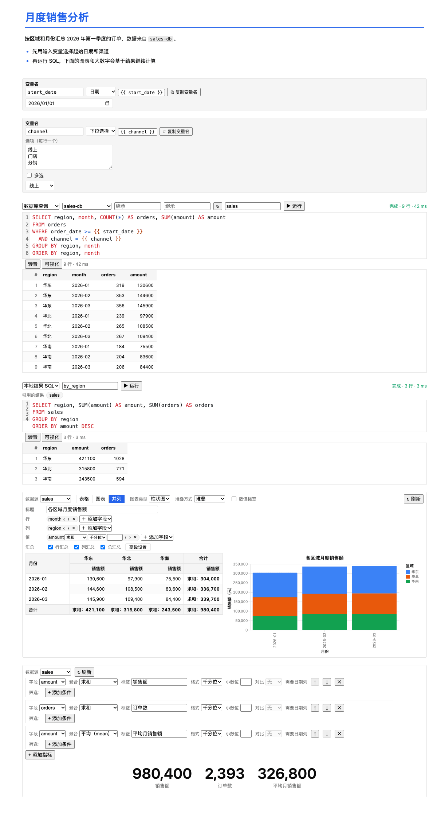
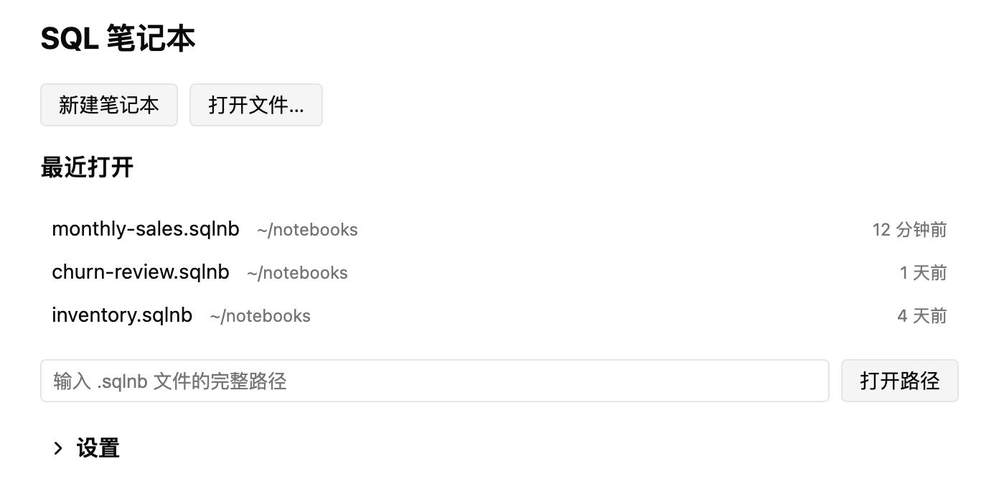

English | [简体中文](README.zh-CN.md)

<h1 align="center">SQL Notebook</h1>

SQL Notebook is a Jupyter-style SQL notebook plugin for DBX. A notebook is saved as a plain-text `.sqlnb` file made of blocks (Markdown, input variable, SQL, local SQL, pivot chart and big number) that are laid out in order and can be run one by one.

Typical uses: analyzing data with SQL while keeping the working steps, building on earlier query results in later blocks, exporting results as a PDF or HTML report, and keeping notebook files in version control to collaborate.

## Overview

- Run read-only SQL on your existing DBX connections. A notebook stores only the connection name, never connection details.
- Input blocks define variables, referenced in SQL as `{{ variable_name }}`.
- SQL block results can be named. Later local SQL, chart and big-number blocks keep computing from those results without touching the database again.
- A chart block is a pivot table plus a chart, with configurable rows, columns, values, totals, sorting and chart type.
- A big-number block shows several metrics, with filters, month-over-month / year-over-year comparison and distinct counts.
- Run results are saved by default in a `.sqlnb.out` file next to the notebook; you can also store them inside the notebook or not at all.
- Export to PDF (needs Chrome, Edge or Chromium on your machine) or self-contained HTML. SQL and Markdown code blocks are syntax-highlighted in exports (Markdown fences support sql, json, yaml, javascript/typescript, python and bash; other languages are not colored).
- Optional AI assistance, powered by the model configured in DBX: generate or rewrite SQL, interpret results, configure charts and generate big-number metrics.
- The file format is public; see [spec/sqlnb-v1.md](spec/sqlnb-v1.md).

 A sample "Monthly sales" notebook (all sample data is fictitious).

## Quick start

1. Download the `.dbxp` package for your system from [Releases](https://github.com/zhengcan/dbx-notebook/releases) (releases currently provide unsigned candidate packages).
2. In DBX, open plugin installation and choose that file. For an unsigned development package, first turn on "Allow installing unsigned development packages" in DBX.
3. DBX 0.6.48 or later is required; older versions refuse to install the plugin.
4. During installation DBX lists the permissions the plugin requests: `host.data:read` (read-only queries), `host.schema:read` (table schema metadata, used for editor completion and the AI's schema context), `host.ai` (call the model to generate text), `host.storage` (save settings and the chat cache), `host.workbench` (set the tab title) and `host.connections:read` (read summary information about connections, without passwords or hosts).
5. Open the "SQL Notebook" workbench. On the start page, click "New notebook" or "Open file…" (`.sqlnb`); you can also choose "New SQL notebook" from the context menu of a DBX connection.
   The start page's "Settings" section is collapsed by default. Expand it to change the maximum number of rows per block and to choose the browser used for PDF export.
6. Choose a default connection in the toolbar. Connections in a notebook are referenced by name; if DBX has no connection with that name you get a notice, and the file is not modified.
7. Add blocks and run them (toolbar "Run all" or a block's "Run"). Save with `Ctrl/⌘+S`.

 The start page, with "Settings" collapsed by default.

## Blocks

Each block type's fields, behavior and limits are described in [docs/blocks.md](docs/blocks.md). In a notebook, use `+ Markdown`, `+ SQL`, `+ Local SQL`, `+ Input`, `+ Chart` and `+ Big number` to insert a new block after any block; every block has move up, move down, duplicate and delete buttons.

### Markdown

For descriptions and headings. Click or double-click the preview to edit; `Ctrl/⌘+Enter`, `Esc` or losing focus returns to the preview. Headings, emphasis, lists, quotes, tables, code and links are supported. Local images next to the notebook can be shown (PNG, JPEG, GIF and WebP, referenced by relative path; paste and drag-and-drop are supported, and the DBX desktop app accepts files dragged straight from Finder/Explorer; remote images are not loaded). Edit mode has a formatting toolbar (heading, bold, italic, code, link, quote, list, table, insert image; `Ctrl/⌘+B/I/K`). Task lists, footnotes and raw HTML are not supported. The content is stored in the block's `content` and is included in exports.

 Markdown block preview.

 The formatting toolbar in Markdown edit mode.

 An image in a Markdown block (stored in the .assets folder next to the notebook).

For the image format, paths, paste/drag-and-drop, save-as and export rules, see the "Images" section of [docs/blocks.md](docs/blocks.md#images).

### Input variable

Defines a variable name, a type (text, number, date, boolean, select) and a value. A select input can allow multiple choices. Reference the variable in SQL as `{{ variable_name }}`; before running, it is replaced with a safe literal for the connection's database type. Running is refused if a variable is unset, has the wrong type, or is written inside a string, comment or identifier. Variable names must match `[A-Za-z_][A-Za-z0-9_]*` (at most 63 characters) and should be unique within the notebook.

 A date input and a select input, referenced in SQL as `{{ start_date }}` and `{{ channel }}`.

### SQL (database query)

Runs a single read-only statement on the chosen connection (`Ctrl/⌘+Enter` or the "Run" button). You can set the result name, connection, database and schema (each can inherit the notebook default). Result tables support sorting, selection, copying (with headers), viewing long values and transposing (available when there are at most 20 rows). The maximum number of rows fetched per block is set in the start page's settings (1–5000, default 5000); anything beyond it is marked as truncated.

 A SQL block: editor, run status and result table.

### Local SQL (SQL on local results)

Runs SQL against earlier named SQL results using the built-in SQLite engine, without touching the database. A result name used where a table is expected acts as a table reference. The syntax is SQLite's, with some Postgres-style functions supported; `::`, `ILIKE`, `DISTINCT ON` and similar are not supported, and errors come with a rewrite hint.

 A local SQL block: further aggregating the named result `sales`.

### Chart (pivot chart)

Choose an already-run SQL block that has a result name as the data source, then configure rows (up to 4), columns (up to 3), values (up to 8; aggregates include sum, count, distinct count, average, min, max and median), totals (row / column / grand total) and sorting. The view can be table, chart or side by side; chart types are line, area, column, bar, scatter, pie, donut and histogram. The "Advanced settings" dialog lets you change field names, metric names, the chart title, axis titles, units, scaling and the display names of category values.

 The chart block's side-by-side view: pivot table on the left, stacked column chart on the right.

 The "Advanced settings" dialog: preview on the left, display names editable one by one on the right.

### Big number

Shows one or more metric cards (up to 8). For each metric, choose a field and an aggregate (sum, average, min, max, count, median, first row, last row, distinct count), and optionally set a label, a format, filters (up to 5) and a month-over-month / year-over-year comparison.

 A big-number block with three metric cards.

## Repository layout

| Path | Contents |
| --- | --- |
| `plugin/` | The DBX plugin: `manifest.json`, `dbx-plugin.toml`, the Rust backend `backend/` and the Vue UI `ui-src/` |
| `packages/sqlnb-format/` | TypeScript library for parsing, serializing and validating `.sqlnb`, parameter rendering and analysis config |
| `spec/` | The file format spec `sqlnb-v1.md`, the JSON Schema and example files |
| `docs/` | User and developer documentation |
| `spikes/` | Early technical experiments, unrelated to plugin features |
| `.github/workflows/` | Release workflow |

## Documentation

- [Blocks](docs/blocks.md)
- [.sqlnb file format guide](docs/sqlnb-format.md); the spec is [spec/sqlnb-v1.md](spec/sqlnb-v1.md)
- [AI features](docs/ai.md)
- [Development](docs/development.md)
- [Release](docs/release.md)
- [Known limits](docs/known-limits.md)

## Development

You need Node.js 22+ and a Rust toolchain. Run `npm install` in the repository root. You can then run the plugin in a browser with the dev host started by `npx @dbx-app/plugin-cli dev --path plugin`, run tests with commands such as `npm test -w plugin/ui-src`, and package with `npx @dbx-app/plugin-cli package plugin`. See [docs/development.md](docs/development.md) for the full guide.

## Release

Publishing a Release on GitHub triggers `.github/workflows/plugin-release.yml`, which builds unsigned candidate packages for five platforms and uploads them to that Release; the DBX Store signs them afterwards. For the steps and checklist, see [docs/release.md](docs/release.md).

## Known limits

- Not every UI behavior has been verified one by one on a real DBX host; the existing checks run in headless Chrome and jsdom.
- PDF export needs Chrome, Edge or Chromium installed locally; without one, export HTML and print it from a browser.
- The local SQL engine caps result rows, size and execution time, and at run time only a single read-only statement is allowed.
- Date parameters are compared as ISO text in local SQL, so `<=` and `=` miss the current day; use `date(column)`.
- The AI "read-only" check is text-level and cannot recognize functions with side effects inside a SELECT.

For the full list, see [docs/known-limits.md](docs/known-limits.md).

## License

[MIT](LICENSE)
