[English](blocks.md) | 简体中文

# 区块能力

文档中的「区块」就是界面里的「块」（如「块类型」），两者含义相同。

本文说明笔记本中每种区块的字段、行为、限制和导出效果。文件中的存储形式见 [.sqlnb 文件格式指南](sqlnb-format.zh-CN.md)；AI 辅助见 [AI 功能](ai.zh-CN.md)。

## 通用操作

- 区块之间有 `+ Markdown`、`+ SQL`、`+ 本地 SQL`、`+ 输入`、`+ 图表`、`+ 大数字` 按钮，在当前区块之后插入。笔记本为空时同样的按钮出现在页面中间。
- 每个区块有 ↑（上移）、↓（下移）、⧉（复制）、✕（删除）。删除 `content` 不为空的区块（Markdown 和 SQL）会先确认；输入、图表和大数字区块直接删除。
- 工具栏：开始页、新建、打开、保存（`Ctrl/⌘+S`）、另存为、执行全部、执行此块及之后、停止（当前块执行完毕后停止）、导出，以及「结果保存」方式和默认连接选择。
- 撤销/重做只用键盘（没有工具栏按钮）：`Ctrl/⌘+Z`，重做 `Shift+Ctrl/⌘+Z` 或 `Ctrl+Y`。覆盖 SQL 和 Markdown 文本、输入变量、大数字指标、图表配置、AI 应用的修改、区块设置和元数据，以及区块的新增、删除、移动、复制和「可视化」；不覆盖运行结果和运行状态、选中等界面状态、AI 对话。连续输入按 800 ms 停顿合并为一步（失焦、`Enter`、切换到别的字段、运行、保存、撤销会结束当前一步）；输入法组合算一步。最多 200 步或约 16 MB；历史只在内存中，打开、新建、另存为时清空，普通保存不清空；撤销回到已保存的状态后「未保存」标记消失。普通输入框、文本框和下拉框内 `Ctrl/⌘+Z` 用浏览器自己的撤销；SQL 编辑器内则作用于笔记本历史（编辑器没有单独的历史）；模态对话框自己处理按键。撤销删除会还原该区块（相同 id、位置和内容），但不还原其运行结果，需要重新运行。撤销/重做后屏幕阅读器会收到「已撤销：…」/「已重做：…」的提示，焦点不会移动。
- 结果不会随笔记本保存时丢失：运行结果的保存方式见「结果保存」一节。

## Markdown

- 字段：`content`（Markdown 源码）。
- 使用：空区块直接进入编辑；点击或双击预览进入编辑；`Ctrl/⌘+Enter`、`Esc`、失去焦点回到预览。输入法组合期间的 Enter 不会触发操作。
- 支持：h1–h6、强调、删除线、嵌套列表和引用、表格（列对齐，宽表格可横向滚动）、行内和围栏代码、分隔线、链接。
- 不支持：任务列表、脚注、原始 HTML（被忽略）。链接在新窗口打开。图片见下文「图片」。
- 编辑切换时区块高度保持不变，页面不会跳动。
- 导出：以相同样式输出，使用固定的浅色配色。围栏代码块（<code>```语言</code>）带语法高亮：支持 `sql`（含 `postgres`、`mysql`、`sqlite`）、`json`、`yaml`/`yml`、`javascript`/`js`、`typescript`/`ts`、`python`/`py`、`bash`/`sh`/`shell`；其他或未写语言的代码块不着色，按纯文本输出，不会猜测语言。

<p align="center">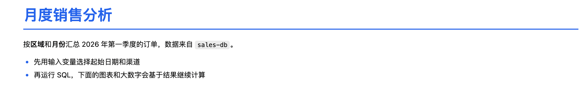<br><sub>Markdown 区块的预览。</sub></p>

### 图片

Markdown 区块可以显示笔记本旁边的本地图片。

- 支持的格式只有 PNG、JPEG、GIF、WebP。AVIF、JPEG XL、HEIC、SVG 等其他格式不支持（显示替代文字或「不支持的图片」），目前也不承诺以后支持。
- 引用方式：用**相对路径**，相对于笔记本所在的文件夹，如 `` 或 ``（`<笔记本文件名>` 含 `.sqlnb`，如 `monthly-sales.sqlnb.assets/`）。`.sqlnb` 文件里只保存这行相对路径文本，图片本身不在文件里；预览和导出时由插件后台读取并以内嵌数据的方式显示。
- 远程 `http(s)` 图片不会加载（只显示替代文字）：插件从不访问网络。`data:image/` 内联图片只接受 PNG、JPEG、GIF、WebP 的 base64，过大的（base64 超过 1 MiB）显示「图片过大」。
- 路径限制：只能引用笔记本所在文件夹及其子文件夹里的文件；不接受绝对路径和 `..`，指向文件夹之外的符号链接会被拒绝。
- 大小限制：显示时单张不超过 8 MiB，约 64 百万像素以内；粘贴或拖入时单张不超过 10 MiB，一次最多 10 张（多出的被忽略并提示）。
- 首次加载时图片会让后面的内容位置变化一次（占位符先显示，加载完成后按图片尺寸撑开）。

<p align="center">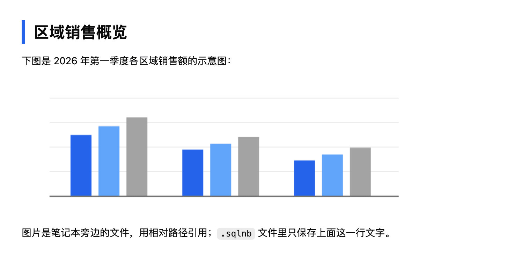<br><sub>Markdown 区块预览中的图片（示意图为生成的示例）。</sub></p>

### 编辑工具栏

编辑状态下，编辑框上方有一行格式工具栏（预览状态没有，所以编辑态比预览态多一行工具栏的高度，一行约 33 px（按钮 28 px），折成两行约 63 px；宽度窄到约 320 px 时工具栏折成两行；工具栏与编辑框连成一体，之间没有间距，只共用一条 1 px 分隔线；编辑框获得焦点时显示 2 px 的主题色聚焦环，画在框内）。共 11 个按钮，分 4 组：

| 分组 | 按钮 |
| --- | --- |
| 行内 | 标题（循环）、粗体、斜体、行内代码 |
| 代码与链接 | 代码块、链接 |
| 块级 | 引用、无序列表、有序列表 |
| 插入 | 表格、插入图片 |

<p align="center">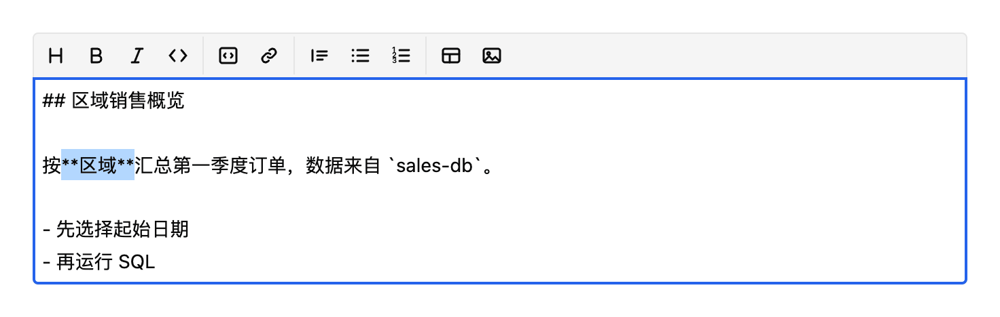<br><sub>编辑状态下的格式工具栏（选中「区域」两字）。</sub></p>

- **快捷键**：`Ctrl/⌘+B`（粗体）、`Ctrl/⌘+I`（斜体）、`Ctrl/⌘+K`（链接），在编辑框内生效。快捷键按物理键位（`KeyB`/`KeyI`/`KeyK`）匹配，Dvorak、AZERTY 等布局上这三个字母所在的位置可能与字母本身不同。macOS 只认 `⌘`（`Ctrl+B` 仍是浏览器的光标左移）；Windows/Linux 只认 `Ctrl`；同时按 Shift 或 Alt 不触发。`Ctrl/⌘+B` 在真实 DBX 中可能与侧边栏快捷键冲突，**待真机验证**。
- **切换和取消**：对已经是该格式的文字再点一次就取消（粗体、斜体、行内代码、链接、引用、列表、代码块都一样）。没有选区时插入占位文字并选中，可以直接输入替换。标题按钮循环：无 → `#` → `##` → `###` → 无（`####` 及更深的直接去掉）。无序和有序列表互相切换；有序列表按 1、2、3 重新编号。
- **取消代码块会丢掉语言行**：去掉围栏时 ```` ```sql ```` 这样的语言标记一并消失。
- **不改写字面文字**：行内代码里的星号、URL 里的星号、`\*` 转义和乘号（如 `2 * 3`、`a*b`）不会被当成粗体/斜体标记；光标或选区严格落在行内代码或 URL 内部时，粗体/斜体按钮不改动文本。标记的识别是启发式，不是完整的 CommonMark 解析，`_` 形式的强调不处理。
- **撤销**：每个按钮动作是**一步撤销**，撤销后光标回到被改动的位置。
- **输入法**：输入法组合期间按钮和快捷键都不起作用（按钮显示为禁用）。
- **键盘**：`Shift+Tab` 从编辑框进入工具栏，`←`/`→`/`Home`/`End` 在按钮间移动，`Tab` 回到编辑框，`Esc` 回到编辑框并保留选区。点击按钮不会让编辑框失去焦点。
- **插入图片**：优先调用 DBX 的文件选择器（`pick`，可多选）；宿主不提供时回退为浏览器的文件选择框。取消选择不做任何事。保存位置、限制与粘贴相同（见下文）。

**粘贴和拖入**：在编辑状态下，把图片粘贴（`Ctrl/⌘+V`，需要编辑框有焦点）或拖入 Markdown 编辑框，插件会把图片保存到笔记本旁边的 `<笔记本文件名>.assets/` 文件夹，文件名为 `image-<日期时间>-<8位哈希>.<扩展名>`（例如 `monthly-sales.sqlnb.assets/image-20261021-093000-3f9a1c2e.png`），并在光标处插入 `` 链接。保存期间可以继续输入：插件按插入点前后的文字重新定位插入位置；编辑与插入点重叠、定位不到时，链接插在当前光标处并提示「保存图片期间文本已被修改，图片已插入到光标处」。拖入落在 emoji 等由两个编码单元组成的字符中间时，链接插在该字符之前。

- 文件夹名由笔记本的完整文件名加 `.assets` 得到，文件名里的 `\ / % : ? # * < > | "` 和控制字符被替换成 `_`，结尾的点和空格被去掉，开头的 `~` 换成 `_`，文件夹名是 Windows 保留名（如 `CON`）时前面加 `_`。
- 插入链接是**一步撤销**；撤销只移除链接，**不会删除**已保存的图片文件。插件从不自动删除图片文件，内容相同的图片会复用已有文件。
- 只有剪贴板里有图片文件而没有文本时才按图片处理；有文本时照常粘贴文本。
- 需要已保存的笔记本：未保存时提示「请先保存笔记本，再粘贴图片」；未保存的笔记本里的相对路径图片显示「保存笔记本后显示图片」。
- 拖入的落点是整个 Markdown 区块，预览状态也可以：此时没有光标，图片链接作为新段落追加到内容末尾（内容非空时前面补空行），区块仍保持预览状态，可一步撤销；保存、数量和大小限制、提示与编辑状态相同。编辑状态下落在编辑框上按落点插入，落在区块其他区域时插入到当前光标处。拖入时区块显示虚线轮廓，拖离后消失；文本、链接等不含文件的拖拽不受影响。拖入 PDF、TXT 等非图片文件时不会保存，也不会让页面跳转到该文件。内容只有空白时，图片链接会替换这些空白。
- **桌面拖放**：DBX 桌面端通过宿主的 `fileTransfer.onDrop` 接收从访达/资源管理器拖入的文件（运行时检测 `capabilities.fileTransfer.drop`；宿主不支持或没有该能力时静默降级为上面的网页拖放）。系统拖放没有落点坐标，所以按下面的优先级选区块：① 正在编辑的区块（图片插到光标处）；② 最近悬停或聚焦过的区块（追加到末尾，多区块时提示「已添加到最近使用的 Markdown 区块（可撤销）」）；③ 笔记本里唯一的 Markdown 区块；④ 以上都不满足时不改动，提示「请先点击要插入图片的 Markdown 区块」（拖拽期间的悬浮条显示同样的提示）。拖拽期间候选区块显示虚线轮廓。这类轻提示显示 3 秒后自动消失；与插入绑定的提示（如「可撤销」）在撤销、重做或文档被其他操作修改时立即消失；错误提示（如「请先保存笔记本」）保留 8 秒。不支持的文件被忽略并提示「已忽略 N 个非图片文件」，文件夹内容过多时只处理前面一部分，读取失败的文件同样计入忽略，其余照常一步插入；同一次拖放的网页事件和宿主事件只处理一次。限制与粘贴相同：单文件 10 MiB、一次最多 10 张、仅 PNG/JPEG/GIF/WebP；文件夹不保留结构。
- 拖入不支持的文件时提示「N 个文件不是支持的图片（仅 PNG、JPEG、GIF、WebP），已忽略」，不保存任何文件。

**另存为**：「另存为」到其他位置时，插件把区块里引用的图片复制到新位置并改写链接；原来的文件保持不动。单次最多复制 500 个文件、共 200 MiB；复制失败的图片会提示「N 张图片未能复制到新位置」，并附前 3 个文件名（只显示文件名，超过 3 个以「…」结尾）。只有真正渲染成图片的链接才会被处理：行内代码、围栏代码块和缩进代码块里的 `` 既不复制也不改写。内联形式 `` 和参考式图片链接（完整 `![alt][ref]`、折叠 `![ref][]`、快捷 `![ref]`）都会改写；参考式改的是 `[ref]: 路径` 定义行，且只改被图片引用的定义。跨行 alt 的链接不处理。

**移动或改名**：如果在插件之外（如访达）移动或重命名笔记本文件，而没有同时移动图片，相对链接会失效，显示「找不到图片」；把文件移回去即可恢复。

**占位符和提示**：图片不能显示时，预览里显示替代文字和原因，屏幕阅读器会读出「替代文字：原因」。原因包括：

| 提示 | 含义 |
| --- | --- |
| 找不到图片 | 文件不存在 |
| 不支持的图片 | 格式不是 PNG、JPEG、GIF、WebP |
| 图片过大 | 超过显示上限 |
| 无效的图片路径 | 路径不符合上述限制 |
| 无法显示此图片 | 解码或读取失败 |
| 保存笔记本后显示图片 | 笔记本还没有保存 |
| 图片加载中 | 正在读取 |

**导出**：HTML 和 PDF 导出把图片内嵌为数据，不产生外部请求。所有图片合计上限 50 MiB；超出上限、读不到或笔记本未保存的图片替换为替代文字，并在导出的信息块里统计数量（「N 张图片未嵌入」）。

**刷新**：插件不监视磁盘，显示过的图片会缓存，同一笔记本打开期间磁盘上被修改的图片不会自动刷新。重新打开同一路径的笔记本会清空图片缓存（磁盘上已变化的图片会重新读取），另存为到新路径也会重置；粘贴新图片后只刷新对应的文件；读取失败的图片 3 秒后可重试。

## 输入变量

- 字段：变量名（`variable`）、输入类型（`inputType`：文本、数字、日期、布尔、下拉选择）、值（`value`）、下拉选项（`options`，每行一个）、多选（`multiple`）。
- 变量名输入框带可见的「变量名」标签，旁边是带边框的 `{{ 变量名 }}` 引用标记；变量名为空时提示「请先填写变量名」。
- 变量名需匹配 `[A-Za-z_][A-Za-z0-9_]*`，最长 63 个字符；与其他输入块重名会提示，且运行引用它的 SQL 时报「有多个输入块」。
- 选项每行一个，只有能原样还原的行才被当作数字（`007`、`1.0`、`1e3` 保持文本），恰好为 `true`/`false` 的行为布尔；重复项会被忽略；不支持引号。
- 切换输入类型时尽量保留值（文本与数字、文本与日期之间可转换），否则清空。
- 「复制变量名」按钮复制 `{{ 变量名 }}`。
- 在 SQL 中引用：`{{ 变量名 }}`。运行前按连接的数据库类型渲染为字面量（文本加引号转义，数字、日期、布尔按方言渲染，多选渲染为 `('a', 'b')`，配合 `IN {{ v }}` 使用）。变量未定义、未设置值（包括文本 `''`）、值无法安全渲染，或引用出现在字符串、标识符、注释中，都会拒绝运行并给出原因。多选没有选中任何项也会被拒绝。
- 日期参数在本地 SQL 中按 ISO 文本比较，见 [已知限制](known-limits.zh-CN.md)。
- 导出：默认在原位置输出一行灰色小字 `变量名: 值`（未设置显示「（未设置）」）；可在导出对话框关闭「包含输入参数」。

<p align="center">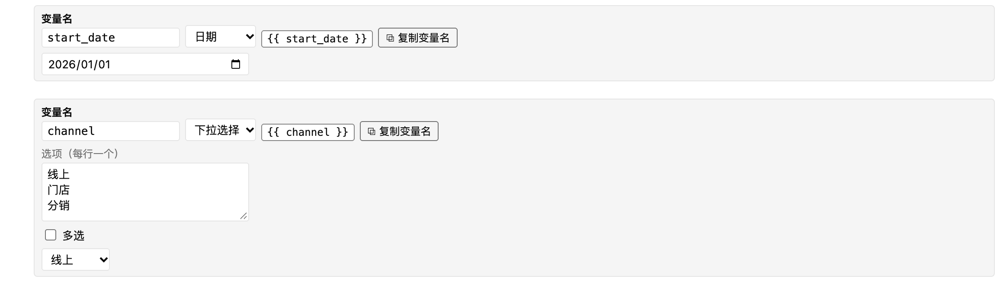<br><sub>日期输入和下拉选择输入。</sub></p>

## SQL（数据库查询）

- 字段：SQL 文本、结果名（`resultName`）、连接（`connection`）、数据库（`database`）、Schema（`schema`）。
- 运行：`Ctrl/⌘+Enter`（在编辑器内）或「运行」按钮。只允许单条只读语句；连接缺失、未连接或插件未获授权时运行按钮禁用并给出原因。
- 连接选择：下拉列表先列出「已连接」的，再列出「未连接」的（灰色，不可选）；笔记本引用但 DBX 中不存在的连接放在最后的「DBX 中未找到」组并带警告。数据库和 Schema 留空时继承笔记本默认值，下拉列表可刷新；不支持 Schema 的方言不显示 Schema。
- 结果名：匹配 `[A-Za-z_][A-Za-z0-9_]*`（最长 63）；在笔记本内不区分大小写地唯一；不能以 `sqlite_` 开头；与 SQLite 保留字相同的名称在本地 SQL 中引用时需要加双引号（界面会提示）。设置了结果名的区块才能被后面的区块引用。
- 结果表：
  - 虚拟滚动，点击表头排序（升序、降序、取消）。
  - 单元格选择：点击，`Shift+点击` 或 `Shift+方向键` 扩展，点击行号/表头选整行/整列，`Ctrl/⌘+A` 全选，`Esc` 取消选择；`Ctrl/⌘+C` 复制为 TSV，`Shift+Ctrl/⌘+C` 带表头复制；右键菜单有「复制」和「复制含表头」；空格键查看选中单元格的完整内容。
  - 过长或 JSON 单元格截断显示，复制仍是完整内容；NULL 以灰色 `NULL` 显示。
  - 「转置」在结果行数 1–20 时可用，选择保存在区块的 `metadata.clients.dbx.transposed`。
  - 「可视化」按钮为当前结果新建一个图表区块；结果没有名称时会自动命名。
- 行数：每块最多取回并保存的行数由开始页「每块最多行数」设置（1–5000，默认 5000，对所有笔记本生效）。超出时结果标记为截断，依赖它的区块显示「基于部分数据」。
- 过期标记：SQL、参数、区块类型或上游结果与保存的结果不一致时，结果显示「已过期」及原因；过期的结果仍然保留。重新运行上游区块不会自动刷新下游。
- 错误：显示数据库或 DBX 返回的错误文本；如果错误与对象不存在有关，会提示检查数据库和 Schema 的选择。
- 导出：结果表按导出对话框的设置输出（见「导出」）。可选在表上方输出 SQL，PDF 和 HTML 中 SQL 带语法高亮（浅色打印配色，颜色在打印时保留，复制出的文本与原 SQL 一致；单块超过 20 万字符或 5000 行时不着色）。

<p align="center">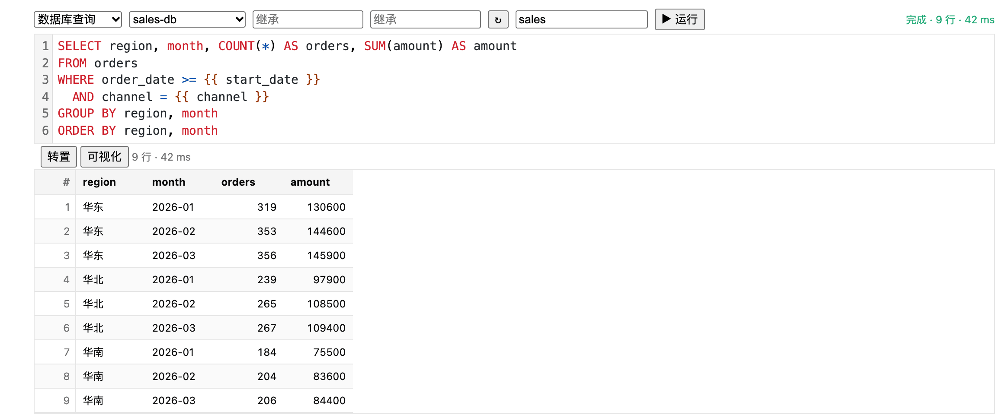<br><sub>SQL 区块：编辑器、运行状态和结果表。</sub></p>

## 本地 SQL（本地结果 SQL）

- 在「块类型」下拉中为「本地结果 SQL」（`metadata.source: "results"`），工具栏的 `+ 本地 SQL` 直接创建这种区块。
- 在插件内置的 SQLite 引擎上运行，针对之前区块的结果。表名即前面区块的结果名；被引用的结果以「引用的结果」标签显示，点击跳转，缺少结果或还没运行时有警告；不能引用自己，不能引用后面的区块，结果名重复时报错。
- 只允许单条只读的 `SELECT` / `VALUES`（可带 CTE）。`EXPLAIN`、`PRAGMA`、DDL、DML、多条语句被拒绝。
- 引擎限制：结果行数上限为每块行数设置；查询超时 30 秒；整个会话最多注册 500,000 行；返回结果的总字节数有上限（64 MiB，超出截断）。
- 方言差异：`::` 转换、`ILIKE`、`DISTINCT ON`、`WITHIN GROUP`、`FILTER` 子句（在本地块中会提示）等写法不支持，运行失败时界面会给出改写建议。完整矩阵见 [spec/sqlnb-v1.md](../spec/sqlnb-v1.md) 的 4.3 节。
- 日期比较：日期参数按 ISO 文本比较，要包含当天请用 `date(列) <= {{名}}` 或 `列 < 次日`，编辑器会在检测到这种写法时提示。
- 本地 SQL 块的结果可以被图表和大数字区块使用。

<p align="center">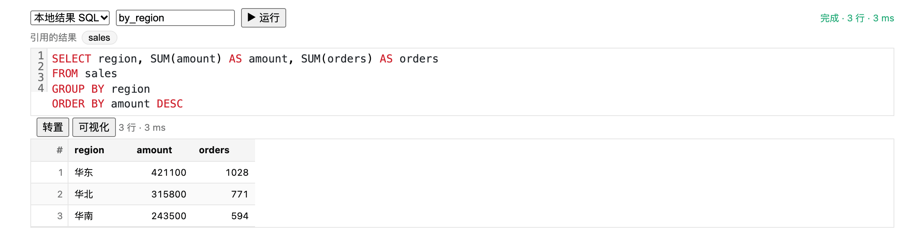<br><sub>本地 SQL 区块：对已命名的结果 `sales` 继续汇总。</sub></p>

## 图表（透视表）

### 数据源和视图

- 「数据源」选择一个已有结果名的 SQL 区块（数据库或本地 SQL 均可）；源块未运行时提示「请先运行源块」。源块重新运行后，图表区块显示「已过期」，点「刷新」重新计算。
- 「视图」：表格、图表、并列。
- 来源中找不到所选字段时，配置会保留并提示，可以在区块内修复。

### 行、列、值

- 行最多 4 个（文件中允许最多 6 个，界面添加到 4 个为止），列最多 3 个，值最多 8 个。每个字段有上移、下移、移除。
- 日期类型的行/列字段可选时间粒度：原始、日、周、月、季、年。周按周一起算。
- 值的聚合：求和、计数、去重计数、平均、最小、最大、中位数；「（行数）」表示对记录计数。值可设置格式（原样、千分位、百分比）和小数位（0–6）。部分聚合对非数值列不可选。
- 字段名最长 256 个字符。

### 汇总

- 「行汇总」在右侧增加一列，「列汇总」在底部增加一行，「总汇总」在右下角增加一格（需要同时有行和列字段）。
- 汇总按表格中显示的单元格计算，不是对原始记录重新聚合；空单元格被忽略。
- 每个值有自己的汇总方式：求和、计数、平均、最小、最大、中位数、跳过。默认跟随值的聚合方式（求和/计数/去重计数 → 求和）。在汇总单元格上双击，或聚焦后按 `Enter`/`F2` 修改，修改会应用到该值的所有汇总。
- 复制的 TSV 只包含数字。

### 排序

- 点击行标题表头按名称排序，点击值列表头按值排序；每次点击在升序、降序、取消之间切换。
- 按值排序时，只有一个单元格的行组按该单元格排序；否则按该值的汇总方式在该行组所有单元格上的结果排序（计数按求和）。没有值的行组在两个方向上都排在最后，相同分数保持键的升序。

### 图表选项

- 图表类型：折线图、面积图、柱状图、条形图、散点图、饼图、环形图、直方图。
- 堆叠方式（柱状图/条形图/面积图，需要「列」字段或多个值）：重叠、堆叠、分组、百分比堆叠。
- 「数值标签」勾选后在图上显示数值。
- 「时间轴」：第一个行字段是时间且图表为折线、面积、柱状、条形时可选「稀疏」（按真实时间位置）或「紧凑」（只显示有数据的时间段，等距排列）。
- 「标题」：图表标题，最长 200 个字符。
- 悬浮提示（仅屏幕上的图表；导出的 HTML/PDF/图片是静态的，外观不变）：折线图、面积图（含多系列、堆叠、时间轴和多个行字段）把鼠标移到绘图区内任意位置，都会显示最近的 X 处所有系列的值：第一行是该 X，其后每个系列一行，按数值从大到小排列，超过 10 个系列时只列前 10 个并附「…另有 N 项」；该 X 上有一条淡色垂直参考线，每个系列在该处有高亮圆点（堆叠面积的圆点落在累计值上）。空值（null）的点不会触发，没有任何有效值的 X 会被跳过。散点图的命中区域放大到直径约 16px，不必精确对准小点。柱状图、条形图、饼图、环形图、直方图的悬浮行为不变。提示里的数值与图上显示的文字一致（单位、换算、千分位等）。
- 饼图和环形图只使用第一个行字段和第一个值；直方图直接对原始记录分箱，不做透视聚合。
- 图表分组点数超过 5000 时提示「点数过多，请减少分组」；透视表最多显示 5000 行、500 列，超出提示截断。
- 只有 `data` 和 `spec`、没有透视配置的旧图表以只读方式显示，保存时不改动。

<p align="center">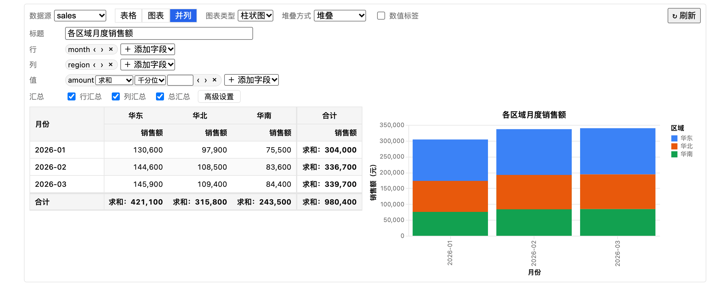<br><sub>图表区块的「并列」视图。</sub></p>

### 高级设置对话框

在配置区点「高级设置」打开（模态，焦点锁定在对话框内，`Tab` 在内部循环，`Esc` 先还原正在编辑且未提交的输入，再关闭；输入法组合期间的 `Esc` 忽略）。每次提交（change、失焦或 `Enter`，不是每次按键）立即生效，是一步撤销，对话框打开时也可以撤销/重做。留空表示自动（对应的键会被删除），已自定义的项显示「已自定义」标记。

四个标签页（方向键、`Home`、`End` 切换）：

| 标签 | 可设置的内容 |
| --- | --- |
| 表格 | 行字段名称、列字段名称、指标名称、汇总文字 |
| 图表 | 图表标题、X 轴标题、Y 轴标题、图例标题 |
| 数值 | 每个值的单位（最长 20 个字符）、缩放（除以；大于 0 且不超过 1e12） |
| 分类值 | 行/列字段的每个分类值的显示名，包括空值（NULL）的显示文字 |

- 每个标签页显示已自定义的项数，并有「此页影响：…」提示；「恢复本页自动（n）」只重置当前页，「全部恢复自动（n）」重置全部，均为一步撤销，无确认。
- 项目按 `n 标题 · 字段` 编号，对话框右侧的预览用小徽标标出对应位置（对话框容器宽度约 640px 以下时隐藏预览）。预览的表格示意最多画 2 个行字段和 2 个列字段，每个字段最多取 3 个示例分类值，图表示意最多 2 个分组（有多个列分组时 3 个）。
- 分类值超过 50 个时出现搜索框（不区分大小写，匹配原值或显示名，最多显示 200 个匹配项）。
- 文本最长 200 个字符，映射最多 200 条；无效值被丢弃并给出提示。
- 数值的显示顺序：除以缩放（百分比：乘 100，忽略缩放）→ 四舍五入 → 千分位 → `%` → 单位。缩放、单位和分类值映射只影响显示：排序、汇总、复制的数值和便携的图表 `spec` 仍使用原始值和字段名；复制的 TSV 表头使用自定义名称。映射不会合并行；两个原始值显示成相同文字时，图表中显示为 `显示名 (原值)`。
- 修改行/列字段时会丢弃该字段的自定义；只改时间粒度时保留名称和空值文字，丢弃分类值映射。
- 另一种入口：点表头或图表标题/坐标轴文字旁的小编辑按钮，打开非模态小窗（输入框、恢复自动、完成）；在聚焦的表头或行标题上按 `F2`、`Shift+F10` 或菜单键也可打开。`Enter` 提交，`Esc` 取消。对话框和小窗不会同时打开。
- 导出始终使用自定义名称、单位、缩放和映射，没有开关。

<p align="center">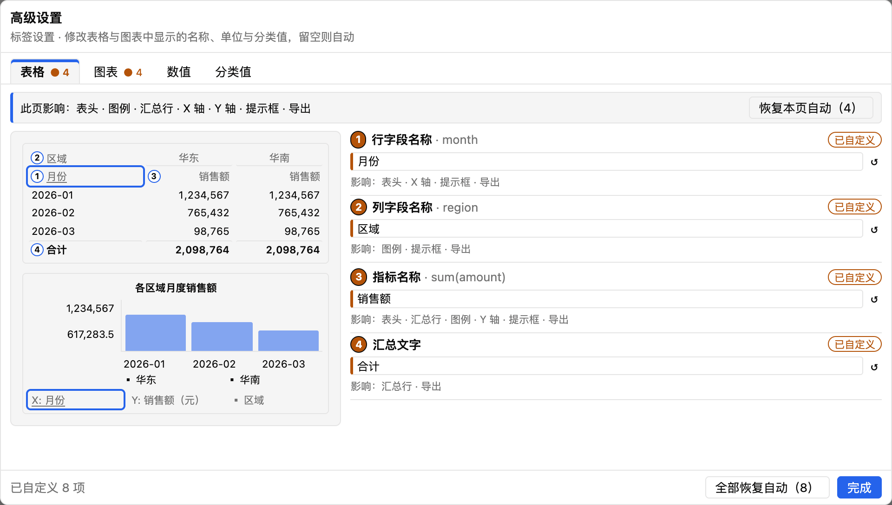<br><sub>「高级设置」对话框。</sub></p>

### 撤销

修改行、列、值、汇总、排序、视图、图表选项和标签都是一步撤销；没有实际变化的修改不写入，也不标记笔记本为已修改。

### 导出

按视图输出表格（透视表，含汇总）和/或图表；图表生成失败时以文字占位并在导出结果中给出提醒。图表标题作为表格上方的标题输出一次。

## 大数字

### 指标

- 一个区块一个数据源（已有结果名的 SQL 区块），最多 8 个指标并排显示；「+ 添加指标」增加，每个指标可上移、下移、移除。
- 每个指标：字段（「（行数）」表示按记录计）、聚合、标签、格式（普通、千分位、百分比）、小数位。
- 聚合：求和、平均（mean）、最小、最大、计数、中位数、第一行、最后一行、去重计数。`average` 是 `mean` 的别名，只为已有文件保留：下拉列表中只有已经使用它的指标才会显示。求和、平均、中位数需要数值字段（对非数值列不可选）；最小、最大对布尔列不可选；去重计数适用于任何列类型，但在「（行数）」字段上不可选；第一行/最后一行按来源结果的行顺序。
- 标签在卡片上最多显示 2 行，完整文字在提示中；同一行的卡片高度相同。

<p align="center">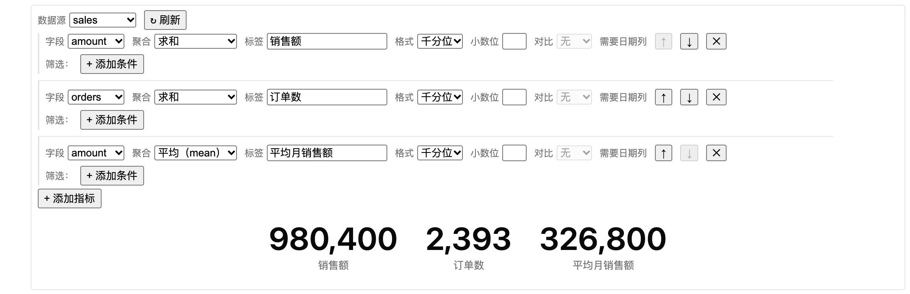<br><sub>大数字区块：三个指标卡。</sub></p>

### 筛选

- 每个指标最多 5 个条件，条件之间为「且」，在聚合之前应用。
- 运算符：等于、不等于、大于、大于等于、小于、小于等于、属于、不属于（最多 50 个值，用逗号分隔）、包含、为空、不为空。
- 数字列用数字，文本和日期列用字符串（日期写成 `YYYY-MM-DD…`），布尔列用 `true`/`false`。文本值会去掉首尾空白，空字符串不是有效值（匹配空单元格请用「为空」）。「包含」只对 ASCII 字母不区分大小写。
- 新增的条件在输入有效之前不会写入笔记本，并显示「尚未保存」。

### 对比（环比/同比）

- 选择对比类型（环比、同比）和日期字段（只能选日期列；没有日期列时禁用并提示）。
- 当前期是**筛选后**的行中最新日期所在的自然月；环比与上一个自然月比，同比与去年同月比；每个期间各自按指标的聚合和筛选计算。卡片显示 `▲/▼ x% 对比 YYYY-MM（环比）`，变化率为（当前 − 上期）/ |上期|。
- 当前月份尚未结束时，与上个月的完整数据比较，不按比例折算。
- 一行的所属月份取其日期文本的前 7 个字符，不做时区转换；数字、无法解析的文本和 NULL 视为没有日期。
- 没有可用日期时显示普通数值并给出提示；日期字段不存在、不是日期列或类型未知时，只有该指标显示错误；上期为空或 0 时变化率显示 `—`。

### 其他

- 「问 AI」根据描述生成候选指标，见 [AI 功能](ai.zh-CN.md)。
- 撤销：手动修改指标和 AI 应用的修改都可以撤销，见「通用操作」。
- 导出：每个指标输出为一张卡片，含对比行；卡片标签同样最多 2 行。

## 导出

工具栏「导出」把当前笔记本最近一次的运行结果输出为只读报告，不会重新运行 SQL；图表和大数字用保存的结果在本地重新计算。

- 格式：PDF（需要本机的 Chrome、Edge 或 Chromium，自动查找，也可在开始页「设置」（默认折叠，点击展开）的「导出：手动指定浏览器路径」中指定：直接输入路径，或用「选择文件…」选浏览器可执行文件，用「选择目录…」选浏览器所在目录或 macOS 的 `.app` 应用，插件会自动解析出其中的可执行文件；留空则自动查找）或 HTML（单个自包含文件，不含脚本和外部请求）。找不到浏览器时 PDF 选项禁用，提示可以导出 HTML 后用浏览器打印。
- 文件名：对话框每次建议 `<笔记本文件名>-<yyyyMMdd-HHmmss>.<扩展名>`，只记住文件夹；HTML 标题和 PDF 文档标题是导出的文件名，不打印笔记本标题。
- 「通用」标签页：格式；查询信息（包含 SQL、包含输入参数）；页眉信息（导出人、导出时间、数据源名称、数据运行时间）；结果表行数（全部或前 N 行，截断时标注「仅显示前 N 行，共 M 行」）；版面（竖版/横版）；每页重复前几列（0–5，默认 0）；报告末尾的说明。
- 「数据区块」标签页：每个区块是否包含，以及每个 SQL 结果表是否转置（跟随当前、开、关）；表格可以手动指定列分页位置或按页数均分。
- 末尾的信息块：导出人、导出时间、数据源名称、各区块的数据运行时间（按区块顺序编号）、说明（最后）。PDF 中信息块不会被分页拆开。导出人是操作系统的用户名，打开对话框且开关为开时由后台通过环境变量读取，只写入导出文件，读不到时该项隐藏。
- 结果表：宽度按内容估算，数值列不换行；文本列在最长单元格或表头不超过 24 个宽度单位（汉字计 2，其他字符计 1）时不换行，更长则换行，不换行列总宽超过 100 单位时最宽的文本列改为换行；表格缩放到页宽，或按列分页，每个列分页都重复序号列。PDF 页脚显示页码。
- 没有运行结果的区块被跳过（对话框事先列出）；仍有区块在运行时不能导出。过期的结果仍可导出，文件中不带过期标记。导出文件不包含连接列表、主机、账号和 AI 对话内容。
- 导出设置保存在 `host.storage`，不写入笔记本。
- 导出完成后的提示框有「确定」和「打开」两个按钮，默认焦点和 Enter 在「确定」上，Esc 关闭；「打开」用系统默认程序打开刚导出的文件（HTML 用默认浏览器，PDF 用默认 PDF 阅读器）并关闭提示框。打开失败时提示框内显示一句错误，不会关闭。后台只会打开本次运行中由插件刚导出的 `.html` / `.pdf` 文件（最近 20 个），不会打开其他路径。导出到网络位置（UNC 路径）的文件不能用「打开」，会提示在文件管理器中打开。

<p align="center">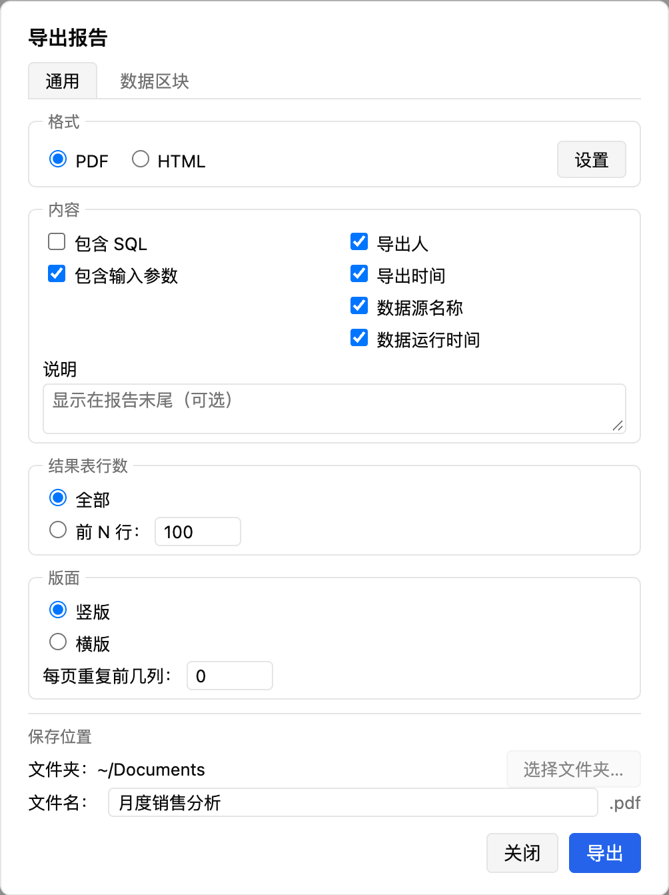<br><sub>导出对话框的「通用」页：格式、内容、结果表行数、版面和保存位置。</sub></p>

<p align="center">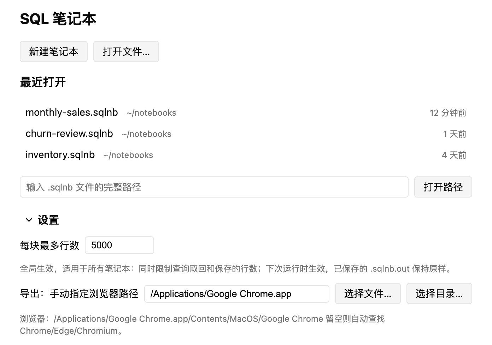<br><sub>开始页展开后的「设置」；示例中的浏览器路径是虚构的。</sub></p>

## 结果保存

工具栏「结果保存」决定运行结果的存放位置：

- 旁路文件 `.sqlnb.out`（默认）：结果写在笔记本旁边的 `<名称>.sqlnb.out`，运行不会改动主文件。
- 写入笔记本（inline）：写在各区块的 `outputs` 字段中，文件会因运行产生差异。
- 不保存：不保存结果；从其他方式切换到此项且已有结果时会先确认，并删除已有的 `.sqlnb.out`。

切换在下次保存时生效。保存时先写主文件再写结果文件；结果文件写入失败不会让主文件保存失败，会提示「结果未保存」。图表和大数字区块不保存结果，打开笔记本后根据来源结果重新计算。保存使用临时文件加重命名，并在写入前检查文件是否被外部修改，被修改时会让你选择覆盖或重新加载。

## 笔记本、标签页标题和连接

### 笔记本标题

笔记本没有整体标题：界面不显示也不编辑，导出也不打印。需要标题时，在顶部放一个 Markdown 区块。格式中没有笔记本标题字段；旧文件 `metadata` 中的 `title` 只是一个未知键，不会被读取或显示，保存时与其他未知键一样原样保留，新笔记本不写入它。

### 标签页标题

宿主支持（能力 `workbenchTitle`；悬浮窗口和侧边栏窗口不支持）时，DBX 标签页标题跟随当前笔记本：不带 `.sqlnb` 扩展名的文件名，有未保存修改时为 `● 名称`，尚无文件的笔记本显示「未命名笔记本」。在打开、保存、另存为和重命名时更新（有节流），关闭笔记本时恢复 DBX 的默认标题。宿主不支持时不发送任何内容，界面不变。标题不包含连接信息。

### 连接

连接选择器和「连接缺失」检查使用宿主的连接列表（`host.getConnections`，权限 `host.connections:read`，能力 `connectionsApi`）。

- 宿主只返回不含机密的摘要：ID、名称、方言、是否已连接、是否只读和（可选的）数据库；不含密码、主机和连接串。
- 列表只保存在内存中，在窗口获得焦点（约每秒最多一次）和点「↻」时刷新；从不写入笔记本、插件存储、AI 对话历史或缓存，不发送给 AI，也不进入导出。笔记本只保存连接的**名称**。
- 笔记本引用了宿主列表中没有的连接名时，笔记本顶部显示提示，相关 SQL 区块显示警告，运行按钮禁用并说明原因；文件不会被修改，也不会标记为已修改。在 DBX 中添加同名连接后刷新即可恢复。列表不可用（权限被拒、宿主较旧或宿主出错）时，选择器会说明，不显示「缺失」提示，笔记本照常运行。
- 连接右键菜单只有「新建 SQL 笔记本」。插件没有自己的连接登记表；旧版插件数据目录中的 `connections.json`（或存储中的 `connections.v1`）会被忽略，可手动删除。

### 权限

| 权限 | 用途 |
| --- | --- |
| `host.data:read` | 在连接上运行只读查询（包括数据库/Schema 列表和 AI 的目录查询） |
| `host.schema:read` | 读取表结构元数据（编辑器的列名补全，以及 AI 的表结构上下文） |
| `host.ai` | 调用 DBX 配置的模型生成文本 |
| `host.storage` | 保存设置、导出选项和 AI 对话缓存 |
| `host.workbench` | 设置标签页标题 |
| `host.connections:read` | 读取连接的摘要信息（必需） |

`engines.dbx` 为 `>=0.6.48`，低版本不认识 `host.connections:read`，会拒绝清单。从旧版本升级时，安装/升级对话框会显示新增的权限。笔记本文件的读写、文件选择对话框、PDF 生成由插件自带的后台进程完成。
